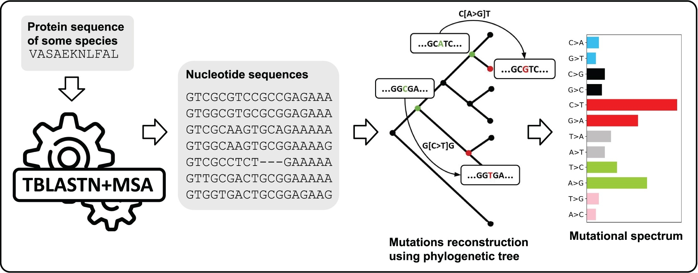

# NeMu

A Nextflow pipeline that reconstructs nearly neutral mutational spectra from orthologous coding or non-coding sequences.

Web server: [nemu-pipeline.com](https://nemu-pipeline.com).



## Article

Bogdan Efimenko, Konstantin Popadin, and Konstantin Gunbin. NeMu: a comprehensive pipeline for accurate reconstruction of neutral mutation spectra from evolutionary data. *Nucleic Acids Research*, Volume 52, Issue W1, 5 July 2024, pages W108–W115. https://doi.org/10.1093/nar/gkae438

## Features

- Protein input: orthologous nucleotide sequences are retrieved with `tblastn` (species hits, then a family-level outgroup). A local nucleotide BLAST database is required.
- Nucleotide input: user-provided coding (`cds`) or non-coding (`noncds`) FASTA files.
- Alignment with MACSE, MAFFT, or both; an IQ-TREE phylogeny and ancestral states; TreeShrink; outgroup rooting.
- 12-class and 192-class spectra.

## Installation

Nextflow 25.10 and the command-line tools are installed together:

```bash
git clone https://github.com/mitoclub/nemu-pipeline-nf.git
cd nemu-pipeline-nf

conda env create -f environment.yml -n nemu --yes
# or: mamba env create -f environment.yml -n nemu --yes

conda activate nemu
```

The `Dockerfile` installs the same packages. Its `ENTRYPOINT` is commented out, so `docker run` does not start the pipeline.

## Input

**Nucleotide input.** One or more FASTA files, each with at least `--minSeqs` sequences (default 4). One record is the outgroup. Its header must contain `OUTGRP`, or the identifier passed with `--outgroupId`. See [K10000.fasta](./test_data/ecoli_nucl_seqs/K10000.fasta). If that record is absent, the tree is rooted on the longest branch, which is not recommended.

**Protein input.** A protein FASTA file. Each header must contain the species name or the NCBI taxid in square brackets. If several pairs of brackets are present, the first pair is used:

```text
>YP_009330816.1 cytochrome b [Stenella longirostris]
MTNIRKT...
>KF153104 CO1 [7906]
MAITRW...
```

`--speciesName` sets the species for every sequence and overrides the bracketed value. See [test_proteins_mtdna.fasta](./test_data/test_proteins_mtdna.fasta).

Protein input also requires the following files, which the pipeline does not download:

- A nucleotide BLAST database. `--db` is the database prefix: `<prefix>.ndb`, `<prefix>.nin`, or `<prefix>.nal` must exist. Species hits below `--minIdentSpecies` percent identity (default 80) or `--minCovSpecies` query coverage (default 0.5) are discarded. The outgroup cutoffs are `--minIdentOutgroup` (default 70) and `--minCovOutgroup` (default 0.5). Identity values are percents. Coverage values are fractions from 0 to 1.
- An NCBI taxdump directory for TaxonKit:

```bash
mkdir -p "$HOME/.taxonkit"
wget -c https://ftp.ncbi.nih.gov/pub/taxonomy/taxdump.tar.gz
tar -xzf taxdump.tar.gz -C "$HOME/.taxonkit"
```

## Usage

Quote glob patterns so that the shell does not expand them. Results are written to `-output-dir` (`results/` when the option is omitted). `-resume` continues a previous run.

### Coding sequences

```bash
nextflow run main.nf \
  -output-dir results_ecoli \
  --inputType cds \
  --input "test_data/ecoli_nucl_seqs/*.fasta" \
  --outgroupId OUTGRP \
  --gencode 11
```

`--gencode` selects the NCBI translation table (default `1`). Use `2` for vertebrate mitochondria and `11` for bacteria. `--aligned true` skips alignment when the file is already aligned. For non-coding sequences, use the same command with `--inputType noncds`. Those sequences are aligned with MAFFT only.

### Protein sequences

```bash
nextflow run main.nf \
  -output-dir results_mtdna \
  --inputType protein \
  --input test_data/test_proteins_mtdna.fasta \
  --gencode 2 \
  --db /path/to/nt \
  --taxdump "$HOME/.taxonkit"
```

## Parallelization

The local executor is the default, and it can use every CPU on the machine. Nextflow reserves one CPU for itself and starts a task when enough CPUs are free. `--threads` (default `1`) is the number of CPUs requested by each BLAST, MAFFT, MACSE, and IQ-TREE task. It is not the number of tasks.

On a 32-core machine, `--threads 1` therefore allows about 31 of those tasks to run at once. To limit the total number of CPUs:

```groovy
// nextflow.config
executor {
    cpus = 8
}
```

With `executor.cpus = 8` and `--threads 4`, two such tasks run at the same time. `-qs` and `executor.queueSize` limit the number of parallel tasks on grid and cloud executors. They do not apply to the local executor.

## Options

Parameter names are camelCase (`--inputType`). The defaults below are those in `nextflow.config`.

- `--input` — FASTA path or glob pattern.
- `--inputType` — `protein`, `cds`, or `noncds` (default `cds`).
- `--gencode` — NCBI genetic code (default `1`).
- `--outgroupId` — outgroup sequence identifier for nucleotide input (default `OUTGRP`).
- `--aligned` — nucleotide input is already aligned (default `false`).
- `--db` — BLAST database prefix (protein input).
- `--taxdump` — directory that contains `names.dmp` and `nodes.dmp` (protein input).
- `--speciesName` — species name or taxid applied to every protein sequence, instead of the FASTA header.
- `--maxHits` — maximum number of `tblastn` hits per query (default `2000`).
- `--minIdentSpecies` / `--minCovSpecies` — species BLAST identity, in percent, and query coverage (defaults `80` and `0.5`).
- `--minIdentOutgroup` / `--minCovOutgroup` — outgroup BLAST identity and coverage (defaults `70` and `0.5`).
- `--threads` — CPUs requested by each task (default `1`).
- `--msaMode` — `auto`, `macse`, `mafft_macse`, or `mafft` (default `auto`). `auto` uses MACSE for 50 sequences or fewer, and `mafft_macse` when there are more.
- `--maxGapSeq` / `--maxGapSite` — drop sequences or columns whose gap fraction is above this value (default `0.5`).
- `--minSeqs` — minimum number of sequences required before phylogeny (default `4`).
- `--minMuts` — minimum number of mutations required before a spectrum is written (default `5`).
- `--treefile` — tree file used instead of a de novo search.
- `--model` and `--modelAsr` — IQ-TREE substitution models (default `GTR+FO+G4+I`).
- `--treeShrink` — prune long branches with TreeShrink (default `true`). If TreeShrink fails, the unpruned tree is used.
- `--treeShrinkQuantile` — TreeShrink branch-length quantile (default `0.1`).
- `--outgroupTopN` — keep the outgroup when its branch is among this many longest branches (default `5`).
- `--rateCutoff` — exclude sites whose rate category is above this value (`0` keeps every site).
- `--proba` — weight mutations by the ancestral-state probability (default `true`).
- `--minProba` — minimum ancestral-state probability when `--proba` is set (default `0.3`).
- `--phyloCoef` — downweight mutations on deep branches (default `true`).
- `--plot` — write spectrum and tree figures (default `true`).
- `--internalBranches` and `--terminalBranches` — also derive spectra for internal or terminal branches.
- `--perBranch` — also derive one spectrum per branch.
- `--minMuts192` — minimum observations required for each 192-class context (default `16`).
- `--help` — print the in-script help and exit.

For a comparison across species, set `--perBranch`, `--model`, `--outgroupId`, and `--rateCutoff` for that alignment. Include one sequence per species so that within-species polymorphism is not counted as a substitution.

Nextflow command-line options: `-o` and `-output-dir`, `-resume`, `-with-report`, `-with-trace`, `-with-timeline`.

## Output

`-output-dir` contains:

- `spectra_total.tsv` — the 12-class synonymous spectrum, with one block per input.
- `parsed_taxonomy.txt` — written only for protein input.
- `<sample>/` — the filtered alignment, `tree.nwk`, ancestral states, observed mutations, and spectrum tables.
- `<sample>/images/` — spectrum plots and the tree figure, when plotting is enabled.

A gene with fewer reconstructed mutations than `--minMuts` does not contribute a spectrum.
